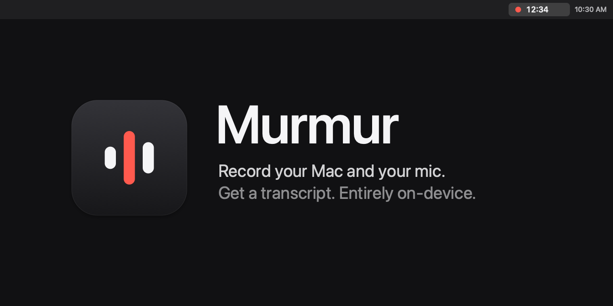

<p align="center">
  
</p>

<p align="center">
  <a href="https://github.com/RovleZMex/murmur/releases/latest"></a>
  
  
  
  <a href="LICENSE"></a>
</p>

<p align="center">
  <b>Murmur</b> is a tiny menu bar app for macOS that records your meetings —<br>
  the other side <i>and</i> your microphone — and turns them into a clean, timestamped transcript.<br>
  No accounts, no cloud, no subscriptions. Everything stays on your Mac.
</p>

<p align="center">
  <a href="#install">Install</a> ·
  <a href="#usage">Usage</a> ·
  <a href="#privacy">Privacy</a> ·
  <a href="#build-from-source">Build from source</a> ·
  <a href="#faq">FAQ</a>
</p>

---

## Features

- **Lives in your menu bar.** One icon shows whether you're idle, recording (with a live timer), paused or transcribing.
- **Records both sides.** Captures your Mac's audio (Zoom, Meet, Teams, a browser tab, anything) and your microphone at the same time.
- **Knows who's talking.** Your mic is labeled **Me**, everything else **Others**, interleaved by timestamp.
- **On-device transcription.** Uses Apple's built-in speech engine (`SpeechAnalyzer`). Nothing is uploaded.
- **Global shortcuts.** Start, pause and stop from any app without touching the mouse — and change them to whatever you like.
- **Make it yours.** Pick the microphone, what to record, where files go, which audio to keep, the language and speaker names.
- **Organized output.** Every session gets its own folder with a Markdown transcript and an `.m4a` recording.
- **Crash-safe.** Audio is streamed to disk while recording, so a crash or power loss doesn't cost you the meeting.
- **100% native and tiny.** Swift, SwiftUI, ScreenCaptureKit. No Electron, no dependencies, no background services.

## Install

1. Download **`Murmur-x.y.z.dmg`** from the [latest release](https://github.com/RovleZMex/murmur/releases/latest).
2. Open it and drag **Murmur** into **Applications**.
3. Launch Murmur. Its icon appears in the menu bar (there's no Dock icon by design).

The app is signed with an Apple Developer ID and notarized by Apple, so it opens without security warnings.

**Requirements:** macOS 26 (Tahoe) or later. Tested on Apple silicon.

### Permissions

The first time you record, macOS asks for:

| Permission | Why |
|---|---|
| **Microphone** | To transcribe what *you* say. |
| **Screen & System Audio Recording** | To capture the audio of your calls. Murmur never records video. |

After granting *Screen & System Audio Recording*, macOS may ask you to quit and reopen Murmur.

## Usage

| | Action | Shortcut |
|---|---|---|
| ▶︎ | Start recording | <kbd>⌃</kbd> <kbd>⌥</kbd> <kbd>⌘</kbd> <kbd>R</kbd> |
| ⏸ | Pause / resume | <kbd>⌃</kbd> <kbd>⌥</kbd> <kbd>⌘</kbd> <kbd>P</kbd> |
| ■ | Stop and transcribe | <kbd>⌃</kbd> <kbd>⌥</kbd> <kbd>⌘</kbd> <kbd>R</kbd> |

When you stop, Murmur transcribes the session and opens the transcript.

### Settings

Open **Settings…** from the menu (or open Murmur again while it's running).

| Tab | Setting | Default |
|---|---|---|
| General | Save recordings in | `~/Documents/Murmur` |
| | Keep audio | One mixed file · separate tracks · none |
| | When a transcript is ready | Open it · show a notification · do nothing |
| | Keyboard shortcuts | ⌃⌥⌘R, ⌃⌥⌘P (click to change, Delete to disable) |
| | Open Murmur at login | Off |
| Recording | Record | Mac audio and microphone · mic only · Mac audio only |
| | Microphone | System default, or any connected mic |
| Transcription | Language | English (US) — any language Apple's engine supports |
| | Speaker labels | Me / Others |

### Output

```
~/Documents/Murmur/
└── 2026-11-10 14.30/
    ├── transcript.md
    └── audio.m4a
```

```markdown
# Session — November 10, 2026 at 2:30 PM

Duration: 00:42:10 · Language: English (United States)

---

**[00:00:03] Me:** Hi Daniel, thanks for joining. Can you walk me through the launch timeline?

**[00:00:09] Others:** Sure. We plan to ship the beta on December 1st and the full release in January.
```

## Privacy

- Audio is recorded and transcribed **entirely on your Mac**.
- The only network access is macOS downloading Apple's speech model the first time you use a language.
- No analytics, no telemetry, no accounts. Your recordings are plain files in `~/Documents/Murmur` that you own.

Always make sure everyone in a conversation agrees to being recorded, as required by the laws where you live.

## Build from source

Requires Xcode 26 or later (for the macOS 26 SDK).

```bash
git clone https://github.com/RovleZMex/murmur.git
cd murmur
make install      # builds, copies to ~/Applications and launches
```

| Command | What it does |
|---|---|
| `make` | Build `build/Murmur.app` |
| `make install` | Build, install to `~/Applications` and launch |
| `make release` | Universal build, Developer ID signed and notarized `.dmg` in `dist/` |
| `make test` | Run the test suite |
| `make assets` | Regenerate the app icon and this README's banner |

<details>
<summary><b>Command-line tools</b></summary>

The app binary doubles as a small CLI:

```bash
# Transcribe any audio file
/Applications/Murmur.app/Contents/MacOS/Murmur --transcribe meeting.m4a en-US

# Re-process a session folder that still has system.caf / mic.caf
# (e.g. if your Mac shut down mid-recording)
/Applications/Murmur.app/Contents/MacOS/Murmur --process ~/Documents/Murmur/"2026-11-10 14.30" en-US
```
</details>

<details>
<summary><b>How it works</b></summary>

| File | Responsibility |
|---|---|
| [`Recorder.swift`](Sources/Recorder.swift) | One `SCStream` captures system audio and the microphone; each track is streamed to its own `.caf`, padded with silence so both stay aligned. |
| [`Transcriber.swift`](Sources/Transcriber.swift) | `SpeechAnalyzer` + `SpeechTranscriber` transcribe each track with timestamps. |
| [`SessionProcessor.swift`](Sources/SessionProcessor.swift) | Interleaves both tracks into `transcript.md` and mixes `audio.m4a`. |
| [`AppModel.swift`](Sources/AppModel.swift) | Recording state machine (idle → recording ⇄ paused → processing). |
| [`MurmurApp.swift`](Sources/MurmurApp.swift) | `MenuBarExtra` UI and CLI entry point. |
| [`HotKeys.swift`](Sources/HotKeys.swift) | Global shortcuts via `RegisterEventHotKey` (no Accessibility permission needed). |
| [`Prefs.swift`](Sources/Prefs.swift) / [`SettingsView.swift`](Sources/SettingsView.swift) | Preferences and the Settings window. |
| [`Tests/`](Tests) | Swift Testing suite: every setting, every combination. |
</details>

## FAQ

**Some sentences appear twice, under both Me and Others.**
You're probably using speakers: your microphone hears the call too. Use headphones for a clean transcript.

**Can it tell apart several remote participants?**
Not yet. Everything coming from your Mac is labeled *Others*.

**Music or noisy audio is transcribed poorly.**
Apple's model is tuned for speech. Conversations transcribe well; songs don't.

**Which languages are supported?**
Every language Apple's on-device speech engine supports on your Mac — pick one in Settings → Transcription.

## Contributing

Issues and pull requests are welcome. For larger changes, please open an issue first to discuss what you'd like to change.

## License

[MIT](LICENSE) © 2026 RovleZMex
